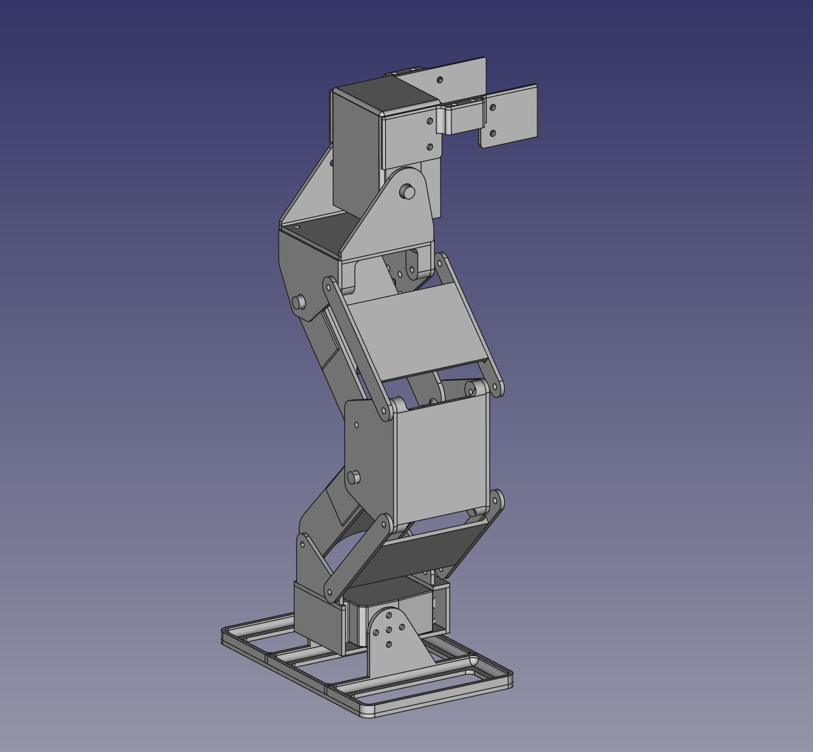

# Kayra 3D-Printable Open Humanoid Robot (Refurbished)



A small 3D-printable humanoid robot designed in FreeCAD. Hobby servos drive the legs and arms, a Pimoroni Servo 2040 runs the body and an optional ESP32-CAM head streams video to a host PC. This is a refurbished remix of [Kayra](https://github.com/assadollahi/kayra) by Ramin Assadollahi and the Kayra community.

## Install and build guide

Kayra is a small 3D-printable humanoid robot designed in FreeCAD. The legs, hips, chest and arms are printed; standard hobby servos drive the joints and a Pimoroni Servo 2040 runs the body. An ESP32-CAM head adds a camera for a host PC that does vision and learning.

### 1. Print the parts

PETG recommended. Print one of each file in the package, and two of the shin (3FU_shin). Parts named L and R are the left and right versions. The number in each file name is its position in the leg, from the foot (1) up to the chest (7) and arms (8-10).

| Group | Files |
|---|---|
| Feet | 1L/1R_foot_bearing, 2L/2R_footJoint_bearing |
| Lower legs | 3BL/3BR_calf, 3FU_shin (x2), 4L/4R_knee |
| Hips | 5L/5R_hipjoint_lower, 5L/5R_hipjoint_upper_bearing, 6F_hipback, 6F_hipfront, 6F_hipfront2, 6L/6R_hip_bearing |
| Chest | 7B_chestback_controller, 7F_chestbase_battery |
| Arms | 8L/8R_shoulder_joint, 9L/9R_upper_arm, 10L/10R_lower_arm |
| Servo mount | servoBlock |

### 2. Electronics and power

- Pimoroni Servo 2040 as body controller (18 servo channels).
- Standard-size hobby servos for the joints.
- A 10 A UBEC for the servo rail and a separate small 5 V BEC for the controller logic.
- A battery pack matched to your servo voltage, with an XT60 lead and a power switch.
- Optional ESP32-CAM for the head.

These parts are not in the shop list:

- Pimoroni Servo 2040: buy it from Pimoroni (pimoroni.com) or a Pimoroni reseller.
- Small ball bearings for the feet and hip joints: read the sizes from the FreeCAD files and buy them from a bearing supplier.

Two power rails: the UBEC feeds the Servo 2040 screw terminal (servos only) and the 5 V BEC feeds the 5 V / GND pads next to the Qwiic connector, so the board also runs without USB. Join all grounds. Connect the battery last, after checking polarity.

### 3. Assembly order

1. Centre every servo before fitting a horn.
2. Build each leg from the foot up: foot, foot joint, calf and shin, knee, hip joint.
3. Join the legs at the hip parts, then fit the chest base with the battery and the chest back with the controller.
4. Fit the shoulders and arms.
5. Wire the servos to the Servo 2040 in joint order and test each joint on its own with low speed.

### 4. Software

The robot-side code is MicroPython for the Servo 2040 and the ESP32-CAM; the host side is Python. A MuJoCo model of the robot lets you test motions in simulation before running them on the hardware.

### Safety

LiPo and Li-ion packs can deliver very high current. Fuse or current-limit the servo rail, never leave a charging pack unattended, and keep fingers clear of the joints when the servos are powered.

### Credits

Based on Kayra by Ramin Assadollahi and the Kayra community, BSD-3-Clause. Changes: grouped print table, one purchase list and a single build guide.

### Software and source links

- Wiring, power and controller connections: `source/upstream/WIRING.md` in this repository.
- MicroPython for the Servo 2040 body and the ESP32-CAM head: `source/upstream/software/robot/` in this repository.
- Host-side Python for vision and learning: `source/upstream/software/host/` in this repository.
- MuJoCo simulation model: `source/upstream/mujoco/` in this repository.
- FreeCAD design files, including bearing seats: `source/upstream/FCStd/` in this repository.
- Project documentation and wiki: https://kayra.org

## Bill of Material

[Bill of Material (PDF)](docs/Kayra%20Humanoid%20Robot%20-%20Bill%20of%20Material.pdf): every part to buy, with shop links.

## Documentation download

This repository is the documentation and source download for the build.

- **Download ZIP:** use GitHub's **Code → Download ZIP** button, or clone:

  ```bash
  git clone https://github.com/ToolKnox/hawkridge-kayra-3d-printable-humanoid-robot.git
  ```

- **Build guide:** this README, also as [`docs/build-guide.md`](docs/build-guide.md).
- **Print files (STL, current design; older and prototype parts in subfolders):** [`source/upstream/STL/`](source/upstream/STL/)
- **Editable CAD (FreeCAD):** [`source/upstream/FCStd/`](source/upstream/FCStd/)
- **Wiring and power notes:** [`source/upstream/WIRING.md`](source/upstream/WIRING.md)
- **Robot software (Servo 2040 body, ESP32-CAM head):** [`source/upstream/software/robot/`](source/upstream/software/robot/)
- **Host software (Python):** [`source/upstream/software/host/`](source/upstream/software/host/)
- **MuJoCo simulation model:** [`source/upstream/mujoco/`](source/upstream/mujoco/)
- **Project documentation and wiki:** https://kayra.org
- **Original upstream README:** [`source/upstream/README.md`](source/upstream/README.md)

## Repository contents

- `docs/`: the build guide and the upstream mirror manifest.
- `download-documentation/`: how to download this package.
- `images/`: cover image.
- `source/upstream/`: mirror of the upstream project at commit `100f3b7b447109989253179a5547fc84471deaa4`, with the STL and FreeCAD files, the robot and host software, the MuJoCo model and the documentation pictures.

## Credits and license

Remix of [Kayra](https://github.com/assadollahi/kayra) by Ramin Assadollahi and the Kayra community, BSD 3-Clause License. Mirrored from commit [`100f3b7`](https://github.com/assadollahi/kayra/tree/100f3b7b447109989253179a5547fc84471deaa4). The cover image is the CAD render from `source/upstream/Pics/`. The upstream license is kept at [`LICENSE`](LICENSE) and [`source/upstream/LICENSE`](source/upstream/LICENSE). No endorsement by the original authors is implied.

Changes by Hawkridge, updated for modern use: a grouped print table, one combined purchase list, two-rail power notes and a single build guide in build order. Files under `source/upstream/` are unmodified.
